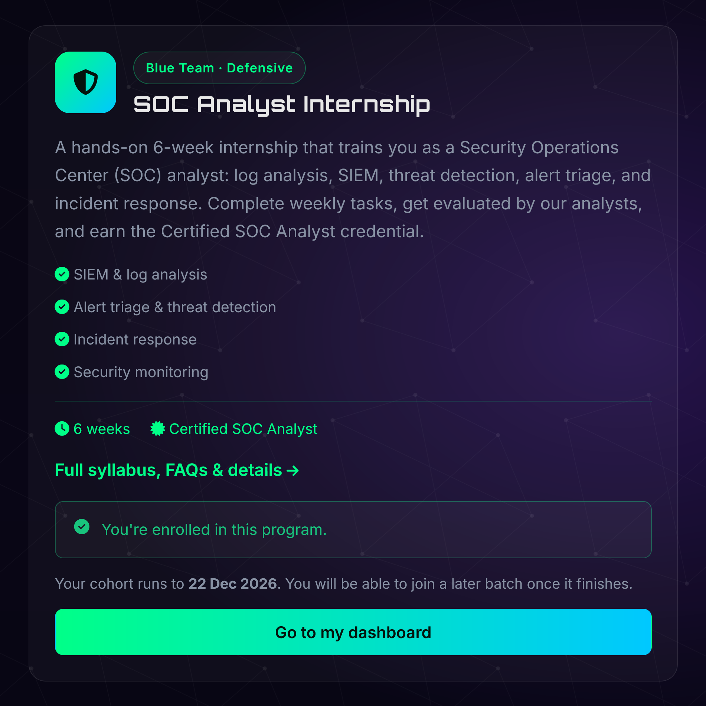
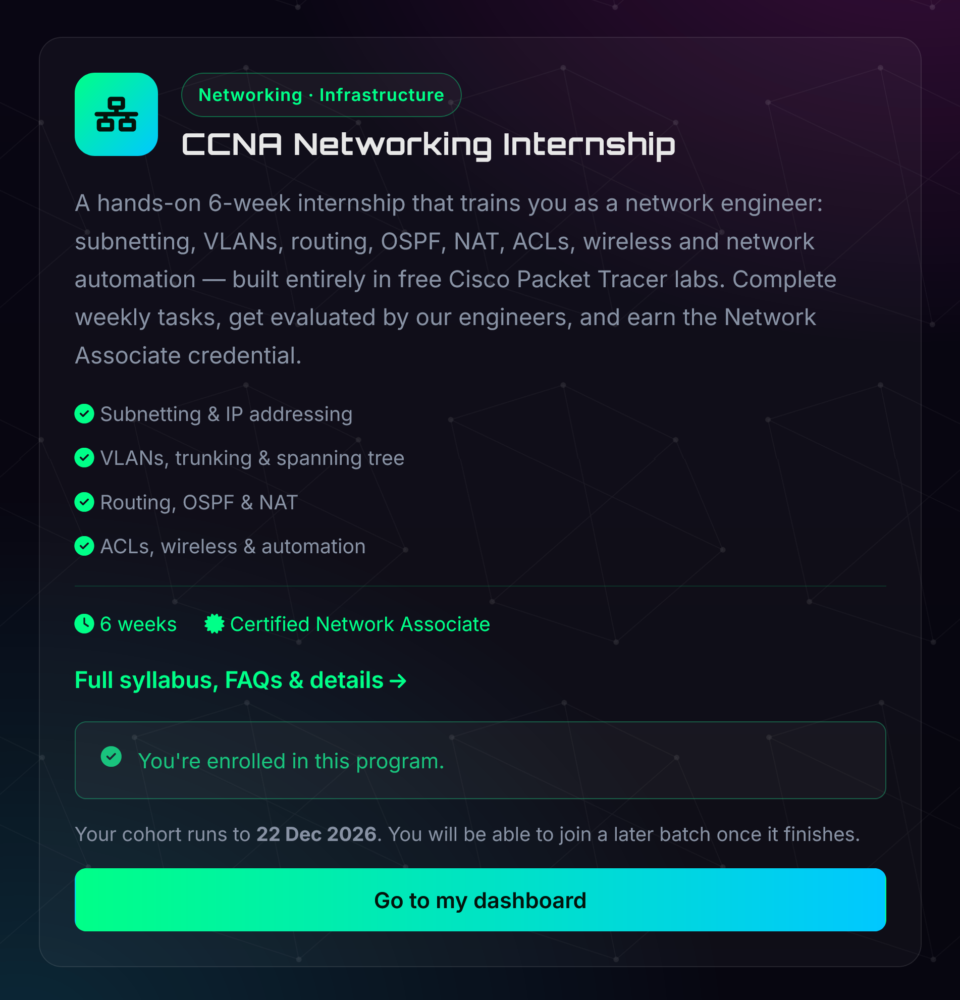

  

  <h1>Techbiz Academy Projects</h1>
  
Executed by

  <h3> Jeffrey Obi</h3>

## Disclaimer

The projects in this repository were undertaken in response to prompts from a training program. They were all executed by me for educational and exhibition purposes only. All tools implemented in their execution were entirely self-owned and self-managed. All security and networking creations, deployments and configurations were undertaken inside virtually simulated and sand-boxed environments. No real security events, identities, production environments or attack victims were engaged while carrying out the projects. All contained screenshots are real evidence of work done, therefore they are original works, which along with all project documentation, constitute my intellectual property.

## Introduction

The Techbiz Academy Internship is a densely-packed paced 6-week 18-module domain-based Cybersecurity training program. In November 2026, I simultaneously enrolled in both 'SOC Analyst' and 'CCNA' internship training programs for the challenge, and a refresher on the fundamentals.

| SOC Analyst Internship | CCNA Networking Internship |
| :---: | :---: |
|  |  |

## Projects

This section contains the completed Cybersecurity & Networking projects from both SOC Analyst' and 'CCNA' programs.

| Week & Task | Issue Date | SOC Analyst Projects | CCNA Networking Projects |
| :---: | :---: | :---: | :---: |
| **Week 1 Task 1** | Nov 10th | [**Cyber Security Intro + What is SOC?**](<./docs/SOC Week 1, Task 1 — Cyber Security Intro + What is a SOC.pdf>) | [**Build Your CCNA Lab + How Networks Actually Work**](<./docs/"CCNA Week 1, Task 1 — Build Your CCNA Lab + How Networks Actually Work.pdf>) |
| **Week 1 Task 2** | Nov 12th | [**Networking Basics for Defenders**](<./docs/SOC Week 1, Task 2 — Networking Basics for Defenders.pdf>) | [**IPv4 Addressing and Subnetting**](<./docs/CCNA Week 1, Task 2 — IPv4 Addressing and Subnetting.pdf>) |
| **Week 1 Task 3** | Nov 14th | [**Lab Setup — VirtualBox + Kali/Ubuntu + Windows VM**](<./docs/SOC Week 1, Task 3 — Lab Setup — VirtualBox + Kali + Windows VM.pdf>) | [**The IOS Command Line, Interfaces and Recovery**](<./docs/CCNA Week 1, Task 3 — The IOS Command Line, Interfaces and Recovery.pdf>) |
| **Week 2 Task 4** | Nov 17th | [**Linux Basics & Log Files**](<./docs/SOC Week 2, Task 4 — Linux Basics & Log Files.pdf>) | [**VLANs and Access Ports**](<./docs/CCNA Week 2, Task 4 — VLANs and Access Ports.pdf>) |
| **Week 2 Task 5** | Nov 19th | Windows Logs & Event Viewer (Event IDs) | Trunking, 802.1Q and the Native VLAN |
| **Week 2 Task 6** | Nov 21th | Understanding Logs & Log Analysis Basics | Spanning Tree and EtherChannel |
| **Week 3 Task 7** | Nov 24th | Malware Types & Common Attacks | Static and Default Routing |
| **Week 3 Task 8** | Nov 26th | Cyber Kill Chain + MITRE ATT&CK Intro | OSPFv2 Single-Area |
| **Week 3 Task 9** | Nov 28th | Network Traffic Analysis — Wireshark Basics | Inter-VLAN Routing and First-Hop Redundancy |
| **Week 4 Task 10** | Dec 1st | What is SIEM? + Install Splunk / Wazuh | DHCP, DNS and NAT/PAT |
| **Week 4 Task 11** | Dec 3th | Ingest Logs into SIEM + Basic Searches | IPv6 Addressing and Dual-Stack Routing |
| **Week 4 Task 12** | Dec 5th | SIEM Dashboards & Alerts | Access Control Lists |
| **Week 5 Task 13** | Dec 8th | Phishing Email Analysis | Device Hardening and Layer 2 Security |
| **Week 5 Task 14** | Dec 10th | Threat Intelligence & IOCs | Wireless Networking |
| **Week 5 Task 15** | Dec 12th | Incident Detection — Investigate an Attack in Logs | Automation and Programmability |
| **Week 6 Task 16** | Dec 15th | Incident Response Process (NIST Phases) | Timed Troubleshooting — Fix a Network You Did Not Build |
| **Week 6 Task 17** | Dec 17th | Hands-on Investigation (LetsDefend / CyberDefenders) | CCNA 200-301 Exam Preparation |
| **Week 6 Task 18** | Dec 19th | CAPSTONE — Full Incident Investigation + Report | CAPSTONE — Design, Build and Document a Full Enterprise Network |

## Other Achievements

This section covers other challenges and achievements from the programs.

